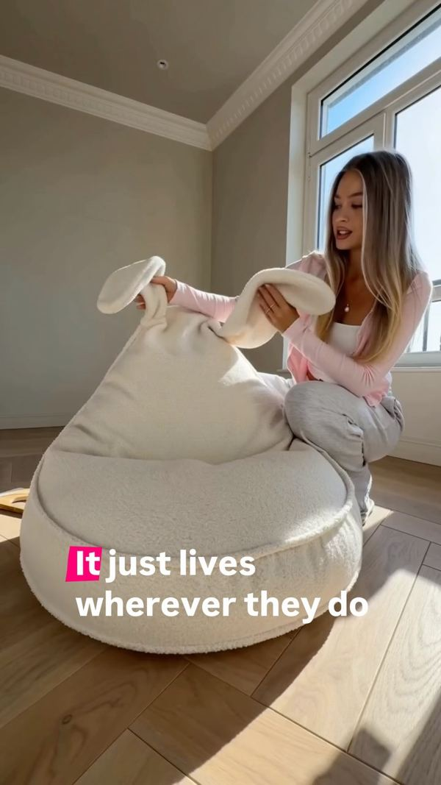

Brands rarely ask me how something was made. They ask what it does for them. Nobody buys a technology. They buy a solved problem: sell the product, explain it, show it at its best, and stay inside the budget.

Here are five jobs where generative tools give a brand a real advantage, and one case where they don't.

## 1. Show the product where you can't ship it

A traditional shoot for furniture or decor costs as much as a small project: location rental, lighting, logistics, a crew. For a small brand that's usually where the idea stops.

AI lets the same product appear in dozens of environments: a bright Scandinavian living room, a dark loft, an autumn morning by the window. The product stays exactly itself; the world around it changes.

## 2. Put motion into something static

A catalogue photo shows the result. Motion shows the feeling: light moving across a wall, fabric responding to touch, a room that breathes.

A short animated piece holds attention in the feed far longer than a still, and nothing has to be filmed for it.

## 3. Make ten versions of a creative instead of one

Paid advertising runs on testing. A single banner never tells you which message works: you need different headlines, different scenes, different emphasis.

Every variation used to mean another shoot or hours of retouching. Now a brand gets a series in one style and switches off whatever underperforms without hurting the budget.

This is the most underrated advantage. Not a prettier picture, but **more attempts for the same money**.

## 4. Keep one style across a whole campaign

When visuals come from different suppliers at different times, a campaign falls apart: different colour, different light, different mood.

A style can be fixed as a rule and everything generated inside it: banners, stories, covers, product cards. The brand becomes recognisable through its atmosphere, not just its logo.

## 5. Test an idea before the production budget

Before spending on a shoot, the idea can simply be seen. Not as a description or a moodboard, but as a finished frame: the character, the location, the light.

The client approves a visual instead of an impression of one. That saves the most expensive resource of all, the time spent redoing things.

## When AI is the wrong answer

When you need the real face of the brand, the real team, the real space, or the trust that comes from "someone actually filmed this". An honest UGC review, product in a real person's hands, still beats any generation. That's why I do both, and choosing the format is part of the brief rather than a matter of taste.

## What I need from a brand to start

- **Product photos** from a few angles, ideally on a plain background.
- **Style references** you like, plus what definitely doesn't fit.
- **Where it will live:** paid ads, feed, stories, marketplace, website.
- **Timing and how many** variations you need.

That's enough for me to quote the work and show the first frames.

Prices for visuals, video and ad creatives are on the [Services & rates](/rates/) page. To talk through a specific task, write to [an.aleshko@gmail.com](mailto:an.aleshko@gmail.com).
