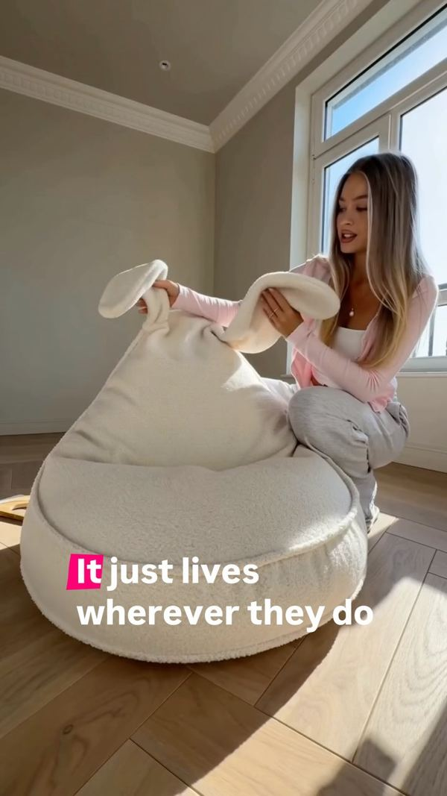
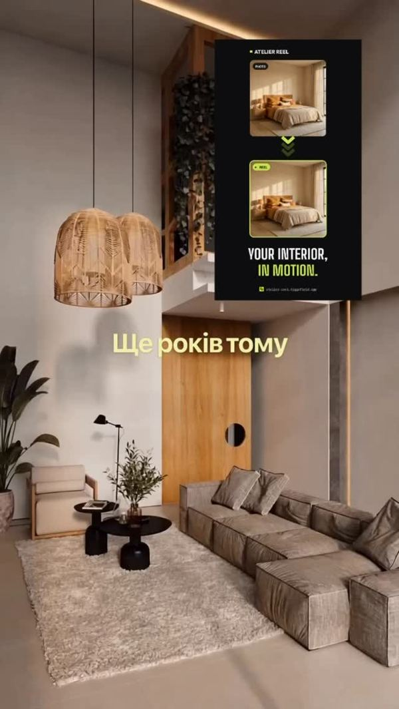

Найчастіше мене запитують не «як це зроблено», а «навіщо це нам». Бренд не купує технологію. Бренд купує рішення задачі: продати, пояснити, показати товар у кращому світлі та вкластися в бюджет.

Ось п'ять задач, де генеративні інструменти дають брендові реальну перевагу. І один випадок, коли вони не потрібні.

## 1. Показати товар там, куди його не привезеш

Класична зйомка меблів чи декору в локації коштує як окремий проєкт: оренда простору, світло, логістика, команда. Часто саме це зупиняє невеликий бренд.

AI дозволяє показати той самий товар у десятках середовищ: у світлій скандинавській вітальні, у темному лофті, восени біля вікна. Товар лишається собою, змінюється світ навколо нього.

## 2. Оживити те, що зазвичай статичне

Каталожне фото інтер'єру показує результат. Рух показує відчуття: як світло повзе по стіні, як тканина реагує на дотик, як простір «дихає».

Коротке відео з такою анімацією тримає увагу в стрічці значно довше за статику, а знімати для цього нічого не потрібно.

## 3. Зробити 10 варіантів креативу замість одного

Таргетована реклама живе на тестах. Один банер не дає відповіді, який меседж працює: потрібні різні заголовки, різні сцени, різні акценти.

Раніше кожна варіація означала нову зйомку або години ретуші. Тепер бренд отримує серію креативів в одному стилі й вимикає ті, що не спрацювали, без шкоди для бюджету.

Це найнедооціненіша перевага: не «гарна картинка», а **кількість спроб за ті самі гроші**.

## 4. Витримати єдиний стиль у всій кампанії

Коли візуали роблять різні підрядники в різний час, кампанія розсипається: різний колір, різне світло, різний настрій.

Стиль можна зафіксувати як правило й далі генерувати в ньому все: банери, сторіс, обкладинки, картки товару. Бренд стає впізнаваним не логотипом, а атмосферою.

## 5. Швидко перевірити ідею до зйомки

Перш ніж витрачати бюджет на продакшн, ідею можна побачити. Не в описі й не на мудборді, а готовим кадром: як виглядатиме герой, локація, світло.

Клієнт погоджує візуал, а не уявлення про нього. Це економить найдорожчий ресурс — час на переробки.

## Коли AI не потрібен

Коли потрібне справжнє обличчя бренду, реальна команда, реальне приміщення або довіра «це зняли на власні очі». Живий UGC-огляд у руках реальної людини досі працює краще за будь-яку генерацію. Тому я роблю і те, і те, а вибір формату — це частина брифу, а не питання смаку.

## Що потрібно від бренду, щоб почати

- **Фото товару** з кількох ракурсів, бажано на простому тлі.
- **Приклади стилю**, який вам подобається, і те, що точно не підходить.
- **Де це житиме:** таргет, стрічка, сторіс, маркетплейс, сайт.
- **Терміни й кількість** потрібних варіацій.

Цього достатньо, щоб я порахувала вартість і показала перші кадри.

Ціни на візуали, відео та рекламні креативи є на сторінці [«Послуги та ціни»](/uk/rates/). Якщо хочете обговорити конкретну задачу — пишіть на [an.aleshko@gmail.com](mailto:an.aleshko@gmail.com).
